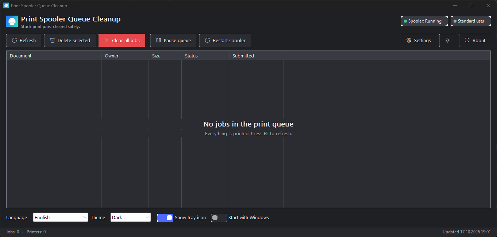
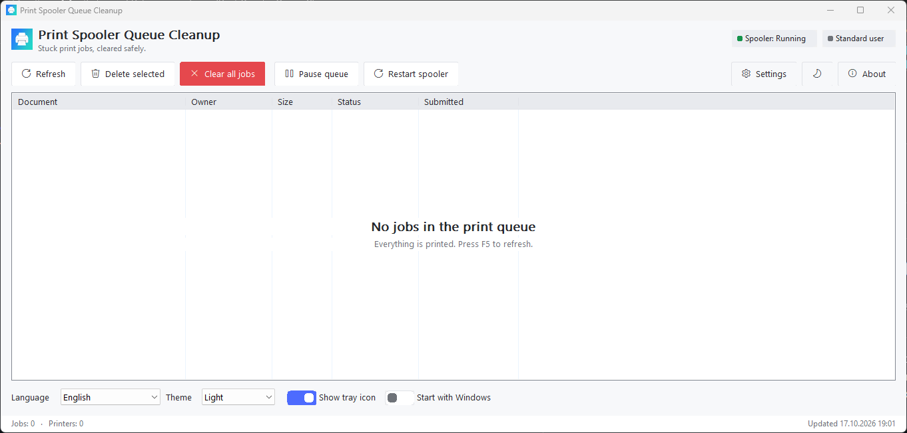

# 🖨️ Print Spooler Queue Cleanup

[](./LICENSE)
[](./docs/BUILD.md)
[](./docs/INSTALL.md)
[](https://github.com/paulmann/Print-Spooler-Queue-Cleanup/actions/workflows/ci.yml)
[](https://github.com/paulmann/Print-Spooler-Queue-Cleanup/releases/latest)
[-brightgreen.svg)](#zero-dependencies)

**A native Win32 utility that shows, pauses, purges and repairs the Windows print queue —
with a modern Fluent-style UI, tray integration, a built-in installer, self-update and
30 languages. One self-contained `.exe`, no .NET, no VC++ redistributable, no SDK required
on the target machine.**

---

## The pain it solves

A print job that fails to render **wedges the whole queue**. The Print Spooler keeps
reporting *Running*, the job sits in *Deleting…* and everything behind it stalls — and
Windows offers no way out that keeps the healthy jobs:

* **Cancel does nothing** — the job is stuck inside the spooler, not in the UI.
* **Restarting the Print Spooler service** throws away every queued document, including
  the forty healthy ones behind the bad job.
* **Hand-deleting** `C:\Windows\System32\spool\PRINTERS` needs an elevated console, a
  stopped service and a steady hand: remove the wrong file and the driver's leftovers
  wedge the queue again on the next print.

So people reboot, reinstall drivers, or call support — for what is really one poisoned
job.

**This tool shows the queue and removes exactly what is stuck**, backs the spool files up
before anything bulk happens, and puts them back in one click if the wrong thing went.

## Screenshots

**Dark theme**



**Light theme**



Both come from the settings row (*Theme*) or from `/theme=dark|light`; *Follow system*
picks up the Windows setting live.

## What it does

The Print Spooler keeps queued jobs as `*.SHD` / `*.SPL` files in
`%SystemRoot%\System32\spool\PRINTERS`. When a job cannot be rendered, a driver faults or a
port monitor blocks, the queue **wedges**: the service reports *Running*, jobs will not
cancel, and everything behind them stalls.

Print Spooler Queue Cleanup v5 gives you a safe, visual way out:

| Capability | How |
|---|---|
| Live queue view | All printers, grouped, with document, owner, size, status, submitted time; auto-refresh |
| Selective delete | Remove only the offending job(s), not 40 healthy ones |
| Clear everything | API purge first; if stubborn — guarded service restart + surgical file sweep (only `*.SPL`/`*.SHD`) |
| Undo insurance | Optional automatic backup of spool files before purge + one-click restore |
| Service control | Pause / resume queues, restart the Print Spooler service |
| Tray guardian | Live job counter in the tray menu, double-click to open, one-click purge |
| Self-update | GitHub Releases check (manual button + daily silent check), in-place replace |
| Built-in installer | First-run wizard: per-user / all-users, folder, shortcuts, autostart — or run once, no install |
| Themes | Light / Dark / Follow-system (auto-detect + live `WM_SETTINGCHANGE` reaction) |
| Languages | 30 UI languages, default = system UI language, RTL for Arabic / Hebrew / Persian |

## Zero dependencies

The shipped `SpoolerCleanup.exe` is **statically linked** and imports only DLLs that are
part of every supported Windows installation (`kernel32`, `user32`, `gdi32`, `comctl32`,
`shell32`, `shlwapi`, `uxtheme`, `dwmapi`, `winspool.drv`, `winhttp`, `advapi32`, `ole32`,
system `msvcrt`). There is **no .NET**, **no VC++ runtime redistribute**, **no PowerShell**,
**no external installer engine** — the installer, updater and uninstaller are built into the
same executable. Copy the exe anywhere and it runs.

## Quick start

1. Download `SpoolerCleanup.exe` from [Releases](https://github.com/paulmann/Print-Spooler-Queue-Cleanup/releases) (or build it, see [BUILD](./docs/BUILD.md)) — the same binary is also on npm: `npx print-spooler-queue-cleanup --help`.
2. Run it. On a new machine the setup wizard asks: install (for me / for all users, folder,
   shortcuts, autostart) **or** run once without installing.
3. The main window shows every queued job. Select → *Delete selected*, or *Clear all jobs*
   for the full nuclear-but-safe path (with optional spool-file backup).
4. The tray icon keeps the live counter: right-click → *Print queue jobs: N*.

Command line (for automation, same exe):

```cmd
SpoolerCleanup.exe /purge            :: clear all queues, exit (code 0 ok, 2 = needs admin)
SpoolerCleanup.exe /list             :: print the job table
SpoolerCleanup.exe /status           :: spooler state + counters
SpoolerCleanup.exe /install /allusers /silent
SpoolerCleanup.exe /uninstall /silent
SpoolerCleanup.exe /tray /portable /lang=ru /theme=dark
```

Full reference: [CLI & automation](./docs/wiki/CLI-and-Automation.md), user guide:
[USER-GUIDE](./docs/USER-GUIDE.md).

## Documentation

| Document | Purpose |
|---|---|
| [docs/USER-GUIDE.md](./docs/USER-GUIDE.md) | Every window, button, hotkey and setting |
| [docs/INSTALL.md](./docs/INSTALL.md) | Installer wizard, silent flags, portable mode, uninstall |
| [docs/BUILD.md](./docs/BUILD.md) | Build from source (MSVC or MinGW), CI, tests |
| [docs/MICROSOFT-STORE.md](./docs/MICROSOFT-STORE.md) | MSIX packaging & Partner Center submission |
| [docs/SMARTSCREEN.md](./docs/SMARTSCREEN.md) | Why Windows may warn about a new .exe and how to make it stop |
| [docs/MIGRATION-FROM-4.x.md](./docs/MIGRATION-FROM-4.x.md) | PowerShell v4 → native v5 feature map |
| [Wiki / knowledge base](https://github.com/paulmann/Print-Spooler-Queue-Cleanup/wiki) | Deep dives: spooler internals, safety model, troubleshooting |

## Safety model (inherited from v4, hardened in v5)

* Only `*.SPL` and `*.SHD` inside the spool folder are ever touched — never other files.
* Locked files are retried, never force-deleted while the service runs.
* Purge prefers the documented API path (`PRINTER_CONTROL_PURGE`); the service restart +
  file sweep only happens when jobs survive the API path.
* Optional backup of spool files before any bulk purge, with a restore dialog.
* Elevation is requested only when actually needed (and only if you allow it in settings).

## Requirements

* Windows 10 (1809+) or Windows 11, x64. Nothing else.
* Administrator rights are required only for cross-user purge / service restart /
  all-users install — the app runs fine as a standard user for your own jobs.

## License & author

Licensed under the [PolyForm Noncommercial License 1.0.0](./LICENSE).
Author: **Mikhail Deynekin** — <icons@Deynekin.com> — [https://Deynekin.com](https://Deynekin.com) —
[repository](https://github.com/paulmann/Print-Spooler-Queue-Cleanup).

The v4 PowerShell implementation is preserved under [`legacy/powershell/`](./legacy/powershell/).
